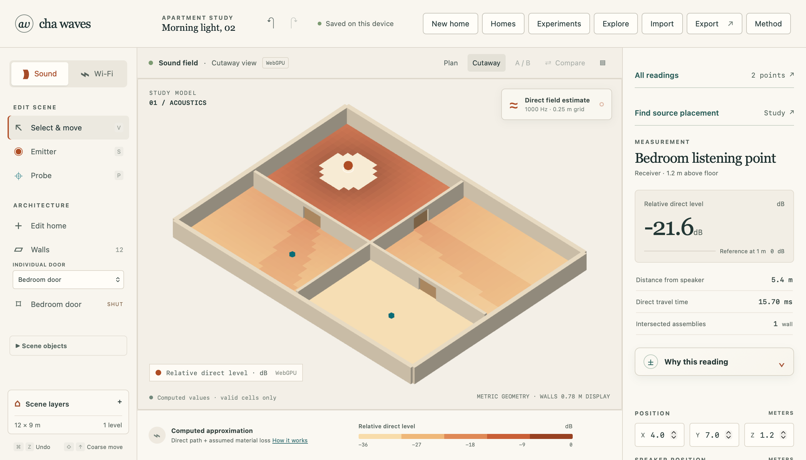
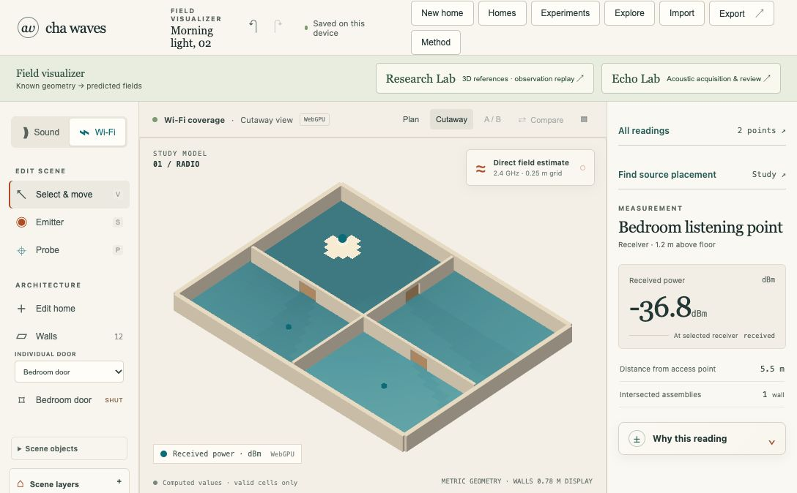
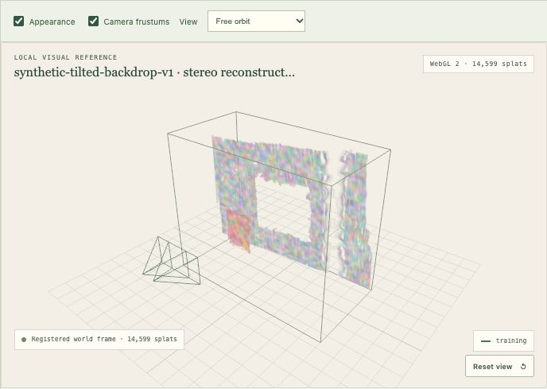
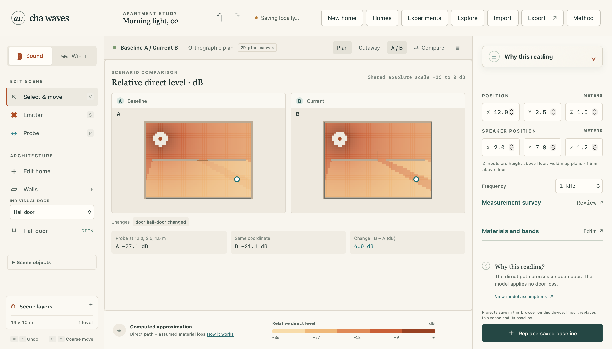

# Cha Waves

**Research into using waves to map 3D visual space, augmented by AI.**

[](https://github.com/alex-red/cha-waves-visualizer/actions/workflows/ci.yml)
[](LICENSE)



*Sound, made visible. An authored apartment, a modeled field and an exact selected-point estimate.*

| Wi-Fi, room by room | Two synthetic images → 3D splats |
|:---:|:---:|
| [](docs/images/wifi-cutaway.jpg) | [](docs/images/stereo-splats.jpg) |
| Modeled received power over known geometry. | 14,599 heuristic Gaussians from supplied synthetic calibration. Holes remain visible; no Gaussian training or AI completion. |

The current application is a local-first browser laboratory for exploring sound and Wi-Fi propagation in an editable floor plan, with separate acoustic and visual research workspaces. Built with Nuxt, Vue, TypeScript, Web Workers and Three.js.

The long-term goal is to map any 3D space and enrich its digital representation with AI reconstruction and completion, including Gaussian splatting. The [spatial research plan](docs/SPATIAL_RESEARCH_PLAN.md) defines the route from controlled acoustic evidence to 3D structure, sensor fusion, visual reconstruction and explicitly generated content. This is a research ambition; general 3D mapping is not implemented or validated.

Close a door, move a source or switch frequency. The field and selected-point explanation recompute from the current inputs. Save a baseline to compare the change on a shared scale. This visualizer predicts fields from known geometry; the mapping research investigates recovering geometry from observations.

**These are educational approximations.** Sound is relative direct-path level, Wi-Fi is modeled received power, and the demonstration material coefficients are authored assumptions. Neither field has been calibrated against a real home. [Model boundaries](docs/PHYSICS_ASSUMPTIONS.md)

## Try it locally

Use **Bun 1.4.3** and **Node 24** (the pinned version is in [.nvmrc](.nvmrc)).

```sh
bun install --frozen-lockfile
bun run dev
```

Open the local address printed by Nuxt. No account, API key or remote solver is needed. The initial Canvas plan works without WebGPU; the optional cutaway has a WebGL2 fallback.

For a production preview:

```sh
bun run build
bun run preview
```

Open [localhost:4173](http://localhost:4173). There is no public hosted demo configured in this repository yet.

## A two-minute tour

1. Toggle **Hall door** and inspect the changed reading. Open **Why this reading** to see the distance and assembly-loss terms.
2. Save a baseline, move the source, then use **A/B** or **Compare** to inspect both scenes with a common scale.
3. Switch to **Wi-Fi**, change the frequency and explore source placement across selected probes.
4. Open **Edit home** to draw or split interior walls, add doors and inspect dimensions. Changes support undo/redo.
5. Open **Echo Lab → Virtual scan**, run all five positions and reveal the synthetic fixture.



*One door, two states. Compare the field on a shared scale and inspect the predicted change at the same point.*

## What is implemented

| Area | Working capability |
|---|---|
| Geometry | Metric plans, calibrated image tracing, constrained wall/door editing, junctions, pan/zoom and numeric controls |
| Numerical models | Separate sound and RF kernels, height-aware crossings, exact probe estimates and signed loss explanations |
| Interaction | Cancellable worker fields, adaptive drag previews, undo/redo and compatible baseline comparisons |
| Local workspace | IndexedDB projects, versioned JSON import/export, named experiments and optional offline app downloads |
| Measurement tools | RSSI survey import and residual metrics; experimental phone audio capture and scan inspection |
| Spatial research | Research Lab with synthetic plane evidence, synthetic and real calibrated-stereo reconstruction/evaluation, hash-verified observation replay and local Gaussian-splat viewing with explicit registration/provenance |

[Portfolio case study](docs/CASE_STUDY.md) · [Architecture](docs/ARCHITECTURE.md) · [Current implementation status](docs/IMPLEMENTATION_STATUS.md)

Try the [synthetic spatial replay](docs/SPATIAL_BUNDLE.md) with `bun run spatial:inspect -- --input packages/test-fixtures/spatial/bundle.json --format markdown`. This registers supplied poses and preserves unknown calibration; it does not recover physical geometry.

Run `bun run spatial:plane-demo -- --format markdown` for the separate [synthetic 3D plane reference](docs/SPATIAL_PLANE_REFERENCE.md). It fits tilted-wall/floor/ceiling fixtures with a fixed speaker and evaluates held-out positions, retaining missing and ambiguous attempts. It is not a validated phone room scan.

The [synthetic calibrated-stereo reference](docs/SPATIAL_IMAGE_REFERENCE.md) reconstructs metric points from self-authored RGB images and supplied calibration, and evaluates two held-out views. A separate [Middlebury 2014 real-stereo cross-check](docs/SPATIAL_REAL_STEREO.md) uses one public calibrated photographic pair and independent structured-light truth. The frozen reduced-resolution run failed all three screening gates: valid-truth coverage 28.795%, >1-pixel disparity error 20.512% among evaluated estimates, and depth P90 error 0.426934 m (maximum 1.400046 m). This is a real-image baseline, not a successful benchmark or independent registration result. Source photos and geometry remain in ignored `local-captures/`; the dataset's [reuse terms](https://vision.middlebury.edu/stereo/data/) are separate from the repository MIT license.

A separate [Census/SGM comparison](docs/SPATIAL_STEREO_COMPARISON.md) retains that baseline and tests frozen development/evaluation cases plus a fresh Motorcycle pair. The candidate passes both real scenes' absolute geometry screens and reduces false-match rates, but fails its sealed synthetic relative screen; Motorcycle's missing-aware gain is only 0.490 percentage points against a required 2 points. SAD remains the default. Run `bun run spatial:stereo:compare -- --split development --output local-captures/my-comparison` for the reproducible development report; `bun run spatial:stereo:sgm -- --help` shows explicit candidate reconstruction usage. Missing support, metre-scale outliers and unknown world placement remain visible.

[Fixed development-only ablations](docs/SPATIAL_STEREO_ABLATION.md) now isolate the matching/filter tradeoffs. Bypassing the texture screen raises synthetic coverage from 36.0% to 82.9%, while adding 247 false matches; the matcher defaults are unchanged. Run `bun run spatial:stereo:ablate -- --output local-captures/my-ablation` to reproduce all nine diagnostics. A fresh four-case evaluation split is pinned and reserved for a later candidate decision.

The [confidence eligibility screen](docs/SPATIAL_STEREO_CONFIDENCE.md) rejects that proposal: it and full Census/SGM accept 100% of an ambiguous periodic-stripe domain, against a ≤1% limit; SAD abstains. Positive geometry and measured resource gates pass, but cannot override this unsupported correspondence. Defaults remain unchanged, and the fresh holdout remains unopened.

The follow-up [fixed local-ambiguity screen](docs/SPATIAL_STEREO_LOCAL_AMBIGUITY.md) accepts no pixels within any of the four unsupported negative masks, including 0/14,848 periodic-stripe pixels, but is also ineligible: exposure/noise coverage is 32.474%, below the 35% positive-case gate. Pooled relative and resource gates pass. No candidate was selected or SAD/SGM defaults changed; holdout-C remains unopened.

The read-only [saved attrition analysis](docs/SPATIAL_STEREO_LOCAL_ATTRITION.md) localizes the 23,613 correct and 318 bad estimates removed by that filter across the five positive cases, including separate forward/reverse and joint failure groups. It reruns no estimator and changes no gate. The next question is whether an additional view can resolve some ambiguous matches; this remains untested, with independent camera/registration evidence still open.

Open **Research Lab** in the app to inspect these references visually or select a local bundle and its source files. It can also open over an active Echo Lab review while keeping the scan in place. [Research workspace guide](docs/SPATIAL_WORKSPACE.md)

In **Visual splats**, load the synthetic metric room, CC0 violin or synthetic stereo reconstruction; inspect camera/scale provenance and save/reopen the original manifest and splat. The Middlebury evaluation is available through its dedicated CLI and stores local source assets outside version control. The violin's world placement remains unknown. Independent world registration, acoustic fusion and AI completion remain future work. [Manual research walkthrough](docs/MANUAL_TESTING.md#research-lab-walkthrough)

## Echo Lab: a separate research experiment

The **virtual scan** fits an axis-aligned rectangle from simulated, unlabeled first-order arrivals at known positions. The **phone satellite** records sweeps for explicit peak review using an optional local relay. The static demo does not need a phone or microphone.


Real Android recordings have exercised acquisition and transfer. A five-probe batch reported complete observed input, while a first-probe timing shift remains unexplained. **No physical wall identification or room-reconstruction accuracy has been established.** Synthetic fit error is not a physical accuracy result.

[3D mapping and AI research roadmap](docs/SPATIAL_RESEARCH_PLAN.md) · [Preliminary research report](docs/RESEARCH_PREVIEW.md) · [Experiment evidence and next gates](docs/ECHO_EXPERIMENT_PLAN.md) · [Phone setup](docs/PHONE_SATELLITE.md)

## Evidence and verification

The repository separates analytical checks, software integration checks and physical experiments. The recorded browser benchmark measured **32.2 ms p95 from worker request to Canvas draw** for a 2,240-cell acoustic fixture on an M4 Pro. That historical run excludes input handling and display presentation; it is not a phone or general performance guarantee. [Scope, raw data and reproduction](docs/PERFORMANCE_EVIDENCE.md)

```sh
bun run test                 # Vitest: numerical packages and composables
bun run test:satellite       # Relay, owner API and Android helper checks
bun run test:tooling         # Capture workflow commands
bun run test:repository      # Repository verification regressions
bun run verify:repository    # Public-file hygiene and local Markdown targets
bun run typecheck            # Run before build; both generate Nuxt state
bun run verify:fixtures      # Independent algebra and portable-project checks
bun run build
bun run verify:static-security
bun run verify:offline
bunx playwright install chromium
bun run test:echo            # Fresh test server; one browser worker
```

For the full browser suite after building, run `bun run test:e2e -- --workers=1`. CI currently runs Chromium only; Firefox and WebKit are temporarily disabled in CI but remain available locally through `PLAYWRIGHT_BROWSERS`. See [verification evidence](reports/PORTFOLIO_VERIFICATION.md) for the checks actually performed and their limits.

## Repository guide

```text
apps/web/       Nuxt interface, rendering adapters, workers and browser tests
packages/       Pure TypeScript geometry, models, formats and analysis
scripts/        Static build checks, benchmarks and optional capture tools
docs/          Case study, model boundaries, workflows and research plan
reports/        Scoped benchmarks and software verification evidence
```

Projects and computation stay in the browser. The optional phone relay receives only captures explicitly sent to it; its private owner API binds to loopback. Keep real recordings, floor plans, keys and private reports outside Git. [Contributing](CONTRIBUTING.md) · [Security](SECURITY.md) · [Documentation index](docs/README.md)

## License

Original project code and documentation are available under the [MIT License](LICENSE). Dependencies retain their own licenses; see [third-party notices](THIRD_PARTY_NOTICES.md) and the [asset inventory](docs/ASSET_AND_DEPENDENCY_INVENTORY.md).
