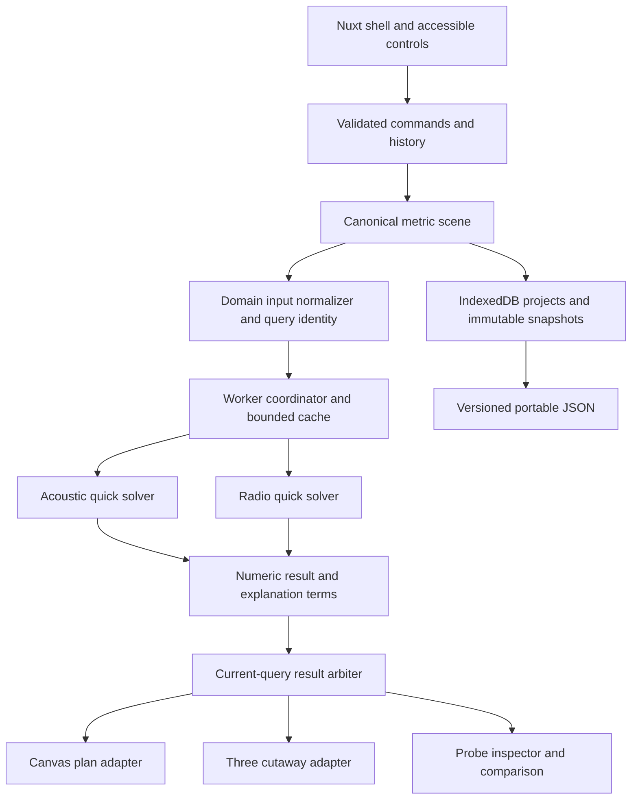
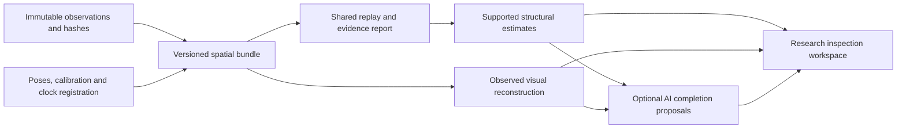

# Engineering architecture

## Current implementation · October 15, 2026

The workspace now separates project lifecycle, history and worker scheduling from the main Vue component. The sections below retain the original architectural plan; the proposed repository layout, Pinia stores, Dexie persistence and cache budgets are not claims about the current implementation.

| Source | Responsibility |
|---|---|
| `apps/web/app/app.vue` | Workspace UI, selection, validated editor actions, pointer interaction and Canvas plan drawing |
| `apps/web/app/composables/useProjectWorkspace.ts` | Validated project installation, import/export, startup restore and serialized 250 ms debounced autosave |
| `apps/web/app/composables/useSceneHistory.ts` | Bounded undo/redo with atomic scene and optional workspace-context snapshots |
| `apps/web/app/composables/useFieldJobs.ts` | Worker lifecycle, cancellation, shared sampling, preview coalescing, baseline requests and accepted-result arbitration |
| `apps/web/app/composables/useExperiments.ts`, `components/ExperimentLibrary.vue` | Full-project validation and atomic history for experiment library/load/baseline actions, plus the native-dialog library UI |
| `apps/web/app/lib/workspace-types.ts`, `clone.ts` | Shared frontend state contracts and snapshot copying |
| `apps/web/app/lib/plan-viewport.ts`, `components/PlanNavigation.vue` | Pure metric viewport transforms and shared plan/editor navigation controls |
| `apps/web/app/lib/drafting.ts`, `components/DraftingOverlay.vue` | Shared endpoint/grid snapping policy, physical length/layout calculations and a pointer-transparent screen-space overlay |
| `packages/field-display.ts` | Shared field palettes, transfer bounds, units, opacity, paper composition and cutaway texture masks |
| `packages/loss-breakdown.ts` | Pure additive point-estimate explanations with current-input identity checks and numerical reconciliation |
| `scripts/offline-build.mjs`, `scripts/offline-worker.js`, `composables/useOfflineWorkspace.ts`, `components/OfflineWorkspace.vue` | Deterministic verified app caches, explicit installation/updates and optional site persistence |
| `packages/survey.ts`, `composables/useSurvey.ts`, `components/SurveyPanel.vue` | Strict raw RSSI contracts, CSV parsing/escaping, context-gated exact comparisons and atomic survey history |
| `packages/materials.ts`, `composables/useMaterialEditing.ts`, `components/MaterialEditor.vue` | Immutable profile updates, conservative exact-band availability, full-project apply validation and draft-only material editing |
| `packages/placement.ts`, `coverage.ts` | Bounded immutable source-position studies and valid-cell RF coverage summaries |
| `apps/web/app/composables/usePlacementSearch.ts`, `workers/placement.worker.ts`, `components/PlacementExplorer.vue` | Independent search lifecycle, stale-input guards and native-dialog results/apply UI |
| `packages/experiments.ts` | Immutable experiment capture/duplication/metadata and complete authored-input differences |
| `packages/engine.ts`, `commands.ts`, `project.ts`, `sampling.ts` | Pure numerical, command, portable-project and sampling contracts |
| `apps/web/app/lib/project-storage.ts` | Direct IndexedDB persistence and recovery |
| `apps/web/app/workers/field.worker.ts` | CPU field evaluation, independent of the renderers |

Imports, startup restoration and home switching share one accepted-document installation route. An explicit project switch supersedes a late startup restore, while a restore that finishes during a selected file's read does not discard that import. Unmount invalidates late work and disposes workers, timers and watchers. Drag previews remain outside project persistence and history.

History entries keep their scene and associated settings/baseline/selection context together. The plan, cutaway and A/B comparison use the same field transfer definitions; cutaway differences require compatible grids and valid cells in both snapshots. Source labels and frequency formatting still live in their UI adapters. Metric coordinate transforms now live in a pure viewport module shared by main-plan drawing/hit tests and the editor's SVG camera. The plan drawing loop remains in `app.vue`.

The inspector's loss-breakdown component consumes the exact point result and authored scene/settings. Its temporary highlight lives in UI state and never enters scene history or project persistence. Plan drawing projects the crossing's exact metric hit independently of the sampled field.

Main and editor cameras are independent, ephemeral UI state. Navigation does not request a new field, alter numerical query identity or enter history/persistence. Camera changes preserve a pending editor wall's metric first endpoint; drafting clicks invert the current transform before existing snapping and command validation. Equal X/Y scale and ruler dimensions come from the same transform.

The editor's hover and click paths share the pure endpoint-first snapping helper. Dimension layout computes lengths from metric endpoints, retains true projected endpoints for clipped lines/ticks and positions labels along the visible span. The overlay uses screen coordinates so text and markers retain their size through zoom. Hover, the dimensions checkbox and pending-wall display never enter canonical scene inputs; accepted walls still pass through the existing command layer.

`split-wall` and opted-in `add-wall` junctions expand a cloned scene into shared-endpoint segments before validating it. Commands retain each original wall ID on the first oriented segment, allocate other IDs across the scene namespace, remap opening spans to one child and enforce the expanded wall cap. Invalid cuts never reach canonical state. One command yields one revision/history entry; ordinary project serialization persists the resulting topology without a format change.

Named experiments are immutable input snapshots in project format 3. The workspace composable includes the library and baseline link in autosave/export; history context carries them atomically with scene/settings/reference state. Loading an experiment keeps the project identity and history, while project installation replaces its library. Format 1 migration retains the original active/baseline inputs with an empty library. Fields remain derived state and never enter experiment records.

Placement studies run in a separate worker from field rendering. Full committed scene/settings and selected-search inputs identify a run, including probe coordinates omitted from the field query hash. Synchronous invalidation terminates superseded workers; only a current accepted candidate can enter the validated move command and history. Search controls, results and RF threshold summaries are derived UI state, excluded from project format 3. RF areas count valid sampled cells at or above the threshold; invalid cells remain explicitly excluded.

Material profiles use the existing scene schema and format 3. `update-material` preserves IDs, display and absorption while replacing the editable coefficient profiles. The material composable validates the complete serialized project before a single history commit. Frequency availability intersects exact rows across referenced wall, door and window materials, including open door leaves conservatively; the solver still resolves missing parameters per actual path.

Survey data is a project-level optional input in format 3, independent of model experiment snapshots. The survey composable validates full candidate projects before import/removal history. The workspace serializes raw observations/context and autosaves survey changes; history snapshots retain the survey. Only an open survey panel derives comparisons. Source/band/context changes disable comparisons, while current geometry/material changes intentionally update predictions. Strict format 1/2 migration retains previous inputs and creates no survey. CSV and project payload limits precede acceptance; file-read generations prevent callbacks from closed/replaced panels.

Current verification, including navigation, drafting, interior junctions, named experiments, placement studies, material profiles, RSSI surveys and offline workspace: 236 unit tests, 137 browser scenarios in each of Chromium and WebKit, strict typechecks, static generation, fixture verification, generated security-header and offline-artifact verification passed. See [implementation status](IMPLEMENTATION_STATUS.md) for scope and remaining release gates.

## System boundaries



Pure domain packages have no dependency on Nuxt, Vue, Three, storage, DOM, audio, or network. The coordinator owns lifecycle and adapters own presentation. Physics never comes from rendered pixels or decorative animation.

## Spatial research boundary · October 17, 2026

The [spatial research plan](SPATIAL_RESEARCH_PLAN.md) adds an inverse-mapping direction alongside the existing forward-modeling workspace. The following Echo infrastructure exists; it is not a general 3D reconstruction pipeline:

| Existing source | Reuse for research |
|---|---|
| `packages/echo.ts` | Chirp/matching helpers and the synthetic four-wall rectangle reference |
| `packages/echo-scan.ts`, `satellite.ts` | Strict portable scans, stable capture/review links and shared PCM decoding |
| `packages/acquisition.ts`, `probe-batch.ts` | Input-continuity metadata and complete repeated-attempt records, including manual pose context |
| `scripts/echo-inspect.ts`, `scripts/lib/echo-report.ts` | Bounded local inspection with hashes, timing candidates and integrity evidence |
| `scripts/echo-pull.mjs`, `scripts/lib/local-scan-api.mjs` | Explicit authenticated retrieval of exact private scan bytes |

The first inverse-research boundary is implemented in `packages/spatial-bundle.ts`, `spatial-registration.ts`, `spatial-report.ts` and `scripts/spatial-inspect.ts`. It validates hash-linked observations and replays supplied registration; it does not recover geometry or synchronize clocks. The [bundle contract and synthetic example](SPATIAL_BUNDLE.md) describe its current scope. The larger pipeline below remains proposed beyond that replay boundary:



The minimal implemented increment joins a strict bundle contract to an offline replay consumer. Pure contracts, frame operations and reporting live in small `packages/` modules. The CLI owns file reads/hashing. Future browser adapters own lifecycle and presentation, and reconstruction/model adapters consume validated immutable inputs. Extend a working consumer before expanding the schema to unused modalities. See the [increment scopes and acceptance](SPATIAL_RESEARCH_PLAN.md#next-implementation-increments).

Research bundles supplement home project format 3 and Echo scan v3; they do not silently change either. Reference original artifacts by hashes and stable IDs, retain manual pose metadata as manual, and expose missing 3D calibration. A scene with X/Y, a manual height and heading is not automatically a calibrated camera/speaker/microphone trajectory. Structure, observed appearance and generated proposals remain separately inspectable. Moving a generated object must not silently edit the field solver's geometry.

Add this boundary in the current repository layout. The existing worker/import/persistence patterns can inform implementation, but avoid a broad package move, new orchestration framework, new cloud dependency or renderer rewrite before replay and its first 3D reference case work. The next acoustic physical test uses existing tooling independently of this proposed architecture.

## Proposed repository

```text
apps/web/                 Nuxt app, styles, UI, renderer adapters, workers, E2E
packages/scene/           schemas, normalization, commands, history
packages/geometry/        intersections, polygon validation, opening semantics
packages/physics/         separate acoustic/ and radio/ engines, shared interfaces
packages/field-engine/    sampling, masks, identity, worker protocol
packages/experiments/     snapshots, compatibility, delta, export
packages/fixtures/        exact demo and analytical scenes
scripts/                  fixture verification and benchmark/report harness
reports/                  generated evidence once measurements exist
docs/                     this planning baseline
```

Start with these boundaries inside a Bun workspace; do not add Turborepo or a custom task graph without need. Physics subdomains share geometry contracts, never attenuation formulas. Suggested UI components: BuildingViewport, SceneTree, GeometryTools, PhenomenonSwitcher, QuantityLegend, FieldInspector, MaterialEditor, ComparisonTray, MethodDrawer, SolverStatus.

## State ownership

| State | Owner | Persistence/identity |
|---|---|---|
| Geometry, materials, emitters, probes | Scene command reducer | Persistent; physical content subsets feed hashes |
| Solver and grid settings | Workspace/domain configuration | Persistent; included in query identity |
| Hover, selection, panels, camera, theme | UI store | Optional preference persistence; excluded from numerical hashes |
| Numeric fields and explanations | Coordinator cache | Derived; bounded in memory; reproducible from manifest |
| Baselines and completed branches | Experiment store | Immutable, versioned, persistent |
| Drag preview | Interaction controller | Ephemeral working scene; one final history command |

Pinia stores contain application state; large arrays and renderer objects remain outside deep reactivity. Pass immutable snapshots across worker boundaries. A receiver move needs a new explanation but does not invalidate the whole field unless its sampling plane/settings changed. Source moves invalidate the active domain; acoustic-only profile edits do not invalidate RF. Geometry changes invalidate both.

## Render strategy

Canvas 2D is the guaranteed plan view with numeric field raster, wall outlines, selection, and handles. Three supplies a dynamically imported orthographic cutaway. A shared geometry projection/hit-testing service converts adapter coordinates into canonical commands; adapters do not maintain editable geometry copies.

Prefer current Three WebGPURenderer/TSL after M0 proves its field/mask material works in native WebGPU and forced WebGL2. If that experiment fails, retain a compatible WebGLRenderer cutaway. A failed GPU adapter request or renderer initialization returns to Canvas; presence of navigator.gpu alone is insufficient. Device/context loss preserves scene/history and offers recovery. Dispose geometries, textures, renderer resources, listeners, and observers on teardown.

Field colorization consumes actual arrays. Lighting and ornament cannot change physical numbers. Keep decorative furniture out of collision and solver indexes. Use clipped, premultiplied overlays, avoid interpolating through masked walls, and generate legends from the exact transfer function. Demand-driven frames wake for pointer movement, accepted result, or explicit motion; pause when hidden.

## Compute lifecycle and cancellation

1. Validate a command against a working scene; normalize domain physical inputs.
2. Allocate increasing request ID and workspace generation. Compute full query hash from relevant scene content, solver ID/version/settings, and grid.
3. Reuse matching cached arrays, otherwise enqueue one latest pending request. Begin with one shared worker because only one domain is active; compare requests are scheduled without spawning unlimited workers.
4. Drag uses a coarse grid and coalesces requests; release supersedes preview with balanced resolution.
5. CPU evaluator processes bounded tiles and yields to the worker task queue so cancel messages can be received. Checking a local flag inside a long synchronous loop alone does not permit message delivery. Terminate/recreate only for an unresponsive job.
6. Result arbiter requires matching generation, request, query hash, solver version, and quality intent. A slower preview cannot overwrite accepted full resolution. Scene revision is supplementary metadata, not sufficient identity.
7. Transfer buffers once; the sender's ArrayBuffer detaches. Cache on the receiving side or deliberately copy if the worker also needs ownership.
8. Publish arrays and matching metadata atomically; exact probe explanation uses the same kernel and query identity.

Bound results to a proposed 32 MiB LRU cache, with byte accounting and eviction. Build geometry indexes once per geometry hash. Start brute-force plus cheap bounding boxes; optimize only against measured hotspots while retaining a reference implementation. Avoid SharedArrayBuffer and GPU readback complexity in P0.

## Persistence and recovery

Dexie-backed stores: projects, snapshots, comparisons, preferences, and schema metadata. P1 adds assets and measurement sets. Autosave debounced after committed commands (proposed 500 ms), with visible saved/unsaved state; drag frames do not write to storage. A baseline is committed atomically and cannot alias mutable scene objects.

Import validates document size, shape, finite values, supported versions, references, and geometric invariants before replacement. Failed imports preserve the current project. Migrations run transactionally with a backup/export path. Unsupported future schemas are rejected, never guessed. Quota or private-mode failures preserve memory state and offer download.

P0 download uses `.cha-waves.json`, contains baseline/branch manifests, and excludes massive arrays by default. Do not expose home data in query strings or upload it. Fixtures can be selected with safe names; a URL cannot supply executable code. Portable result recomputation requires compatible solver code; unsupported solver versions produce an explicit upgrade/recompute choice.

## Static deployment and privacy

Prerender public content and a lightweight lab shell; initialize browser storage, workers, audio, and renderers only on the client. Lazy-load cutaway/audio modules; deploy generated static output on a CDN host supporting MIME, worker paths, CSP, and direct route loads. Host selection is a later operational decision; no backend is needed.

Self-host fonts and assets. Use HTTPS and a tested CSP, immutable caching for hashed assets, and revalidation for HTML/manifests. No default analytics or raw-plan logs. No cross-origin isolation headers are needed for ordinary WebGPU and transferable-worker P0; add them only if a later SharedArrayBuffer design requires them and hosting tests pass.

“Local-first” means computation and projects stay on-device. The optional [offline workspace](OFFLINE_WORKSPACE.md) adds verified static asset caches and a root-scoped service worker. Installation is explicit; updates precache separately and wait for a saved-project reload. Exact old assets remain available to open tabs. IndexedDB project data stays separate from app caches. Browser storage can be cleared or evicted; portable exports remain the recovery path. A hosted sync service requires a separate access, retention, privacy, and cost design.
